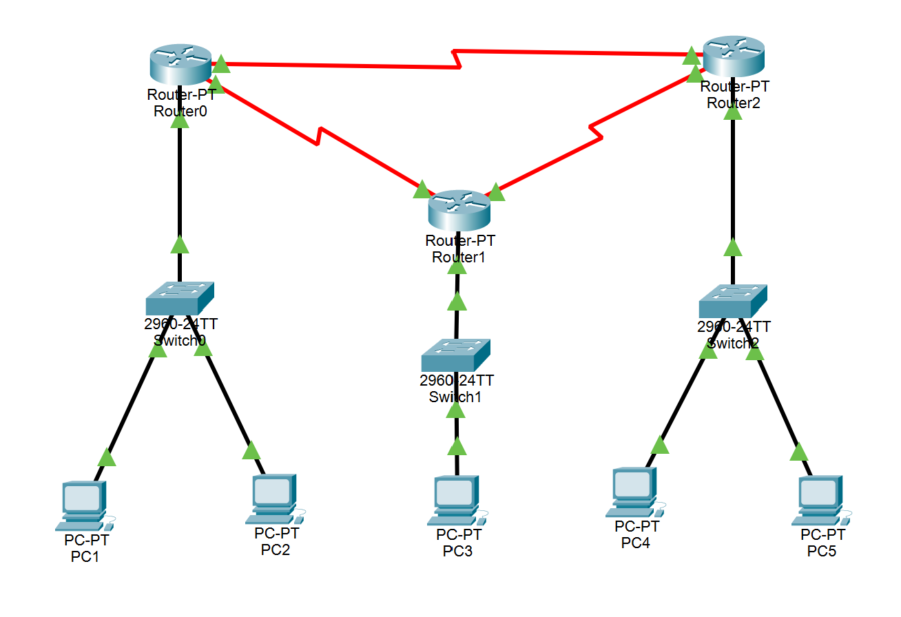
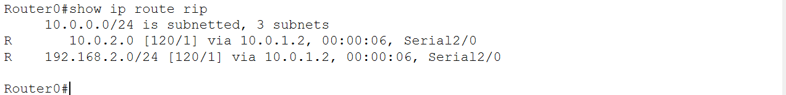
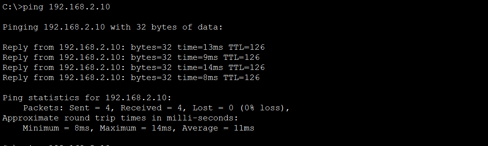

# Design and Simulation of an Enterprise Network using RIP

 
- **Course:** Computer Networks Lab (PBL)
- **Tool:** Cisco Packet Tracer (version: 9.0.1.0858)
- **Protocol:** RIP version 2
- **Team:** Abhik Paul (), Susmita
- **Live page:** https://abhikpaul1.github.io/rip-enterprise-network/
## 1. Aim
 
Connect three LANs with routers over serial WAN links and use RIP v2 so that every LAN can reach every other LAN automatically, without any static routes.
 
## 2. RIP in brief
 
- Distance-vector routing protocol; the metric is hop count (maximum 15, and 16 means unreachable)
- Every router shares its routing table with its neighbours every 30 seconds
- Administrative distance is 120
- RIP v2 carries subnet masks and sends updates to the multicast address 224.0.0.9
## 3. Topology
 

 
- 3 routers (Router-PT) connected in a triangle, 3 switches (2960-24TT), 5 PCs
- Router to Router: serial links (red Serial DCE cable). Each cable has a DCE end that supplies the clock and a DTE end
- Switch to Router and PC to Switch: straight-through cables (black)
- The triangle gives two paths between any two routers, so RIP can re-route when a link fails
- The switches use default settings and need no configuration
## 4. IP addressing
 
All subnet masks are 255.255.255.0 (/24).
 
| Network | Subnet |
|---|---|
| LAN0 (Router0, Switch0, PC1 and PC2) | 192.168.1.0/24 |
| LAN1 (Router1, Switch1, PC3) | 192.168.2.0/24 |
| LAN2 (Router2, Switch2, PC4 and PC5) | 192.168.3.0/24 |
| Router0 - Router1 serial link | 10.0.1.0/24 |
| Router1 - Router2 serial link | 10.0.2.0/24 |
| Router2 - Router0 serial link | 10.0.3.0/24 |
 
| Router | Fa0/0 (to switch) | Serial2/0 | Serial3/0 |
|---|---|---|---|
| Router0 | 192.168.1.1 | 10.0.1.1 (to Router1, DCE) | 10.0.3.2 (to Router2, DTE) |
| Router1 | 192.168.2.1 | 10.0.1.2 (to Router0, DTE) | 10.0.2.1 (to Router2, DCE) |
| Router2 | 192.168.3.1 | 10.0.2.2 (to Router1, DTE) | 10.0.3.1 (to Router0, DCE) |
 
| PC | Connected to | IP address | Default gateway |
|---|---|---|---|
| PC1 | Switch0 | 192.168.1.10 | 192.168.1.1 |
| PC2 | Switch0 | 192.168.1.11 | 192.168.1.1 |
| PC3 | Switch1 | 192.168.2.10 | 192.168.2.1 |
| PC4 | Switch2 | 192.168.3.10 | 192.168.3.1 |
| PC5 | Switch2 | 192.168.3.11 | 192.168.3.1 |
 
## 5. Router configuration
 
Open each router, go to the **CLI** tab and paste its block. If Packet Tracer asks *"Would you like to enter the initial configuration dialog?"*, type `no` and press Enter first.
 
`clock rate 64000` is set only on the DCE end of each serial link. `version 2` and `no auto-summary` make RIP advertise exact subnets. `write memory` saves the configuration so it is not lost when the `.pkt` file is reopened.
 
**Router0**
 
```
enable
configure terminal
hostname Router0
interface fastethernet 0/0
 ip address 192.168.1.1 255.255.255.0
 no shutdown
interface serial 2/0
 ip address 10.0.1.1 255.255.255.0
 clock rate 64000
 no shutdown
interface serial 3/0
 ip address 10.0.3.2 255.255.255.0
 no shutdown
router rip
 version 2
 no auto-summary
 network 192.168.1.0
 network 10.0.0.0
end
write memory
```
 
**Router1**
 
```
enable
configure terminal
hostname Router1
interface fastethernet 0/0
 ip address 192.168.2.1 255.255.255.0
 no shutdown
interface serial 2/0
 ip address 10.0.1.2 255.255.255.0
 no shutdown
interface serial 3/0
 ip address 10.0.2.1 255.255.255.0
 clock rate 64000
 no shutdown
router rip
 version 2
 no auto-summary
 network 192.168.2.0
 network 10.0.0.0
end
write memory
```
 
**Router2**
 
```
enable
configure terminal
hostname Router2
interface fastethernet 0/0
 ip address 192.168.3.1 255.255.255.0
 no shutdown
interface serial 2/0
 ip address 10.0.2.2 255.255.255.0
 no shutdown
interface serial 3/0
 ip address 10.0.3.1 255.255.255.0
 clock rate 64000
 no shutdown
router rip
 version 2
 no auto-summary
 network 192.168.3.0
 network 10.0.0.0
end
write memory
```
 
PCs: open each PC, then **Desktop > IP Configuration > Static**, and enter the IP address, subnet mask 255.255.255.0 and default gateway from the PC table above.
 
## 6. Verification
 
Run on each router:
 
```
show ip interface brief
show ip route
show ip protocols
```
 
What to expect:
 
- `show ip interface brief`: FastEthernet0/0, Serial2/0 and Serial3/0 are all `up / up`
- `show ip route` on Router0 has two RIP routes (lines starting with `R`):
```
R    192.168.2.0/24 [120/1] via 10.0.1.2
R    192.168.3.0/24 [120/1] via 10.0.3.1
```
 
- `show ip protocols`: RIP, version 2, "Automatic network summarization is not in effect"
### Ping tests
 
From a PC open **Desktop > Command Prompt**. The first ping can time out while ARP resolves; run it again.
 
| # | Test | Expected | Result |
|---|---|---|---|
| 1 | PC1 to PC3 (`ping 192.168.2.10`) | Reply | ⬜ |
| 2 | PC1 to PC4 (`ping 192.168.3.10`) | Reply | ⬜ |
| 3 | PC3 to PC5 (`ping 192.168.3.11`) | Reply | ⬜ |
| 4 | Failover: shut the Router0 - Router1 link (below), wait about a minute, ping PC1 to PC3 | Reply, now via Router2 | ⬜ |
 
<!-- Change each ⬜ to ✅ only after you have run that test. -->
 
Failover test (test 4): one cable joins Serial2/0 on Router0 and Serial2/0 on Router1, so shut it on both routers:
 
```
configure terminal
interface serial 2/0
shutdown
end
```
 
Run these four commands on Router0 and again on Router1. After about a minute (use Fast Forward Time in Packet Tracer) `show ip route` on Router0 shows `192.168.2.0/24` with metric 2 via 10.0.3.1, and the ping still works. Restore the link with `no shutdown` on Serial2/0 of both routers.
 
### Evidence
 

 

 

 
## 7. Repository contents
 
```
rip-enterprise-network/        (branch: main)
├── README.md                      this report, also the live page
├── RIP-Enterprise-Network.pkt     Packet Tracer project file
└── screenshots/
    ├── topology.png
    ├── ip-route.png
    ├── ping.png
    └── failover.png
```
 
## 8. How to run
 
1. Install Cisco Packet Tracer (same version as noted above, or newer).
2. Download [RIP-Enterprise-Network.pkt](RIP-Enterprise-Network.pkt) and open it.
3. Click a router, open the **CLI** tab and run `show ip route`.
4. Click a PC, open **Desktop > Command Prompt** and ping a PC in another LAN.
## 9. Deployment
 
Hosted with GitHub Pages: **Settings > Pages > Source: Deploy from a branch > Branch: `main`, folder: `/ (root)`**. The live URL is at the top of this page.
 
## 10. Conclusion
 
RIP v2 gave all three LANs full connectivity over the serial links without static routes, and the triangle design lets traffic take the other path when one link goes down.
 
<!-- Keep this conclusion only if every test above passed. -->
 
